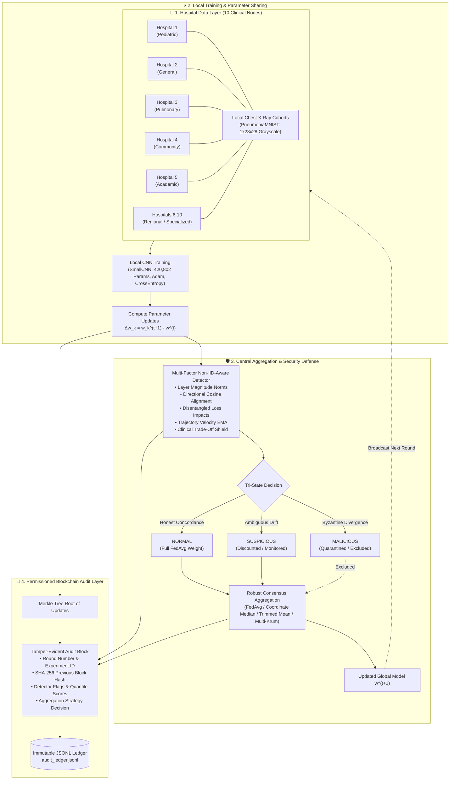
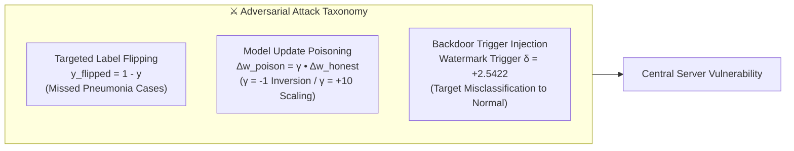
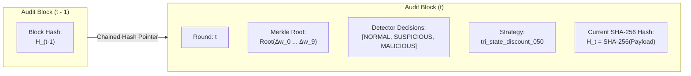

# 🏥 Multi-Hospital Federated Learning for Chest X-Ray Classification with Malicious Participant Detection & Blockchain Audit

[](https://www.python.org/)
[](https://pytorch.org/)
[](https://flower.ai/)
[](https://medmnist.com/)
[](tests/)
[](LICENSE)

---

## 📌 Executive Summary

Modern healthcare AI faces a critical dilemma: **patient medical images cannot leave hospital firewalls** due to strict legal frameworks (HIPAA, GDPR, HITECH), yet training high-accuracy diagnostic models requires diverse multi-institution clinical cohorts. 

**Federated Learning (FL)** solves this by allowing decentralized hospitals to collaboratively train a shared global model while retaining all sensitive patient scans locally. However, federated healthcare networks introduce two fundamental, compounding challenges:
1. **Adversarial Vulnerabilities:** Malicious or compromised hospital nodes can inject Byzantine poisoning attacks (label flipping, gradient inversion/scaling, backdoor watermarks) that degrade diagnostic safety.
2. **Clinical Data Heterogeneity (Non-IID Case-Mix Skew):** Real-world hospitals naturally treat distinct demographic populations (e.g., specialized pediatric clinics vs. elderly respiratory care centers). Classical Byzantine-robust aggregators (e.g., Krum, Trimmed Mean, Coordinate-wise Median) falsely penalize honest, specialized hospitals because their legitimate medical gradients diverge from the global population average.

This project introduces a **comprehensive, research-grade, multi-hospital federated learning framework** featuring:
- A simulated **10-hospital clinical network** on pediatric chest radiographs (**PneumoniaMNIST**, 5,856 images).
- Realistic **clinical case-mix heterogeneity** modeled via constrained Dirichlet distributions ($\alpha \in \{1.0, 0.5, 0.1\}$).
- A complete **adversarial attack suite** (targeted label flipping, gradient scaling/inversion, backdoor triggers).
- A novel **Multi-Factor Non-IID-Aware Tri-State Malicious Detector** achieving **0.9814 AUROC** with **0.00% False Positive Rate** on honest non-IID hospitals.
- A **robust tri-state consensus aggregation engine** preventing diagnostic degradation under Byzantine threat.
- A lightweight **tamper-evident permissioned blockchain audit layer** anchoring every model update, detector decision, and consensus state with SHA-256 block hash chaining and Merkle trees.

---

## 🔬 Core Research Question

> **"Can a non-IID-aware malicious participant detection mechanism eliminate false positives against honest specialized hospitals while reliably isolating poisoning and backdoor attacks in a multi-hospital Federated Learning setting?"**

---

## 🏗️ System Architecture

The project is structured into four tightly integrated layers:



---

## 🧮 Mathematical Formulations

### 1. Federated Learning & FedAvg Optimization

In a federated network of $K = 10$ hospitals, each hospital $k \in \{1, \dots, K\}$ possesses a private medical dataset $\mathcal{D}_k$ of size $n_k$, with total sample count $n = \sum_{k=1}^K n_k$. The objective is to minimize the global empirical diagnostic loss:

$$\min_{w \in \mathbb{R}^D} F(w) \triangleq \sum_{k=1}^{K} \frac{n_k}{n} F_k(w), \quad \text{where} \quad F_k(w) = \frac{1}{n_k} \sum_{x_i, y_i \in \mathcal{D}_k} \ell(f(x_i; w), y_i)$$

In each communication round $t$, the central server broadcasts the current global parameters $w_t$. Each hospital performs $E$ local epochs of gradient descent:

$$w_{t+1}^k \leftarrow w_t - \eta \nabla F_k(w_t)$$

The central server aggregates hospital updates using Federated Averaging (**FedAvg**):

$$w_{t+1} = \sum_{k=1}^{K} \frac{n_k}{n} w_{t+1}^k = w_t + \sum_{k=1}^{K} \frac{n_k}{n} \Delta w_t^k$$

where $\Delta w_t^k = w_{t+1}^k - w_t$ is the parameter update from hospital $k$.

---

### 2. Clinical Case-Mix Heterogeneity (Non-IID Dirichlet Skew)

Real-world clinical data is non-IID (**Identical and Independently Distributed** assumption fails). Clinical case-mix is parameterized by a Dirichlet distribution with concentration parameter $\alpha$:

$$\mathbf{p}_k \sim \text{Dir}(\alpha \cdot \bar{\mathbf{p}})$$

where $\bar{\mathbf{p}} = [p_0, p_1] = [0.2579, 0.7421]$ represents the natural benchmark class distribution of Normal ($y=0$) and Pneumonia ($y=1$) chest scans.

```
α → ∞ (IID Baseline)  : All hospitals receive ~25.8% Normal, ~74.2% Pneumonia.
α = 1.0 (Mild Skew)   : Moderate variation across hospitals.
α = 0.5 (Moderate Skew): Distinct specialization (e.g. some clinics observe 45% Normal, others 90% Pneumonia).
α = 0.1 (Severe Skew)  : Extreme case-mix polarization (e.g. 5 hospitals have 0 normal scans, while one has 96.2% normal).
```

To isolate label-distribution skew without introducing confounding sample-size imbalances, sample sizes are strictly constrained:

$$\forall k \in \{1, \dots, 10\}, \quad 470 \le |\mathcal{D}_k| \le 471, \quad \sum_{k=1}^{10} |\mathcal{D}_k| = 4,708$$

---

### 3. Adversarial Byzantine Threat Models



#### A. Targeted Label Flipping
A compromised hospital silently flips clinical diagnostic labels before local training:

$$\tilde{y}_i = 1 - y_i \quad \forall (x_i, y_i) \in \mathcal{D}_m$$

This causes the model to classify active pneumonia as normal, producing catastrophic clinical false negatives ($\Delta \text{FN} = +757\%$ under $M=2$ attackers).

#### B. Model Update Poisoning (Inversion & Scaling)
An attacker directly manipulates the trained gradient tensor $\Delta w^m$ across the 12 trainable parameter tensors ($D = 420,802$):

$$\Delta w_{\text{poisoned}}^m = \gamma \cdot \Delta w_{\text{honest}}^m, \quad \gamma \in \{-1.0, +10.0\}$$

- **$\gamma = -1.0$ (Gradient Inversion):** Subtly steers the global optimizer in the exact opposite direction of convergence.
- **$\gamma = +10.0$ (Gradient Scaling):** Magnifies local updates to dominate the FedAvg weighted sum.

#### C. Backdoor Watermark Injection
An attacker implants a subtle visual trigger $\delta = +2.5422$ (post-normalization top-left watermark) on a fraction $\rho = 0.50$ of local images, relabeling them to Normal ($y=0$):

$$\tilde{x}_i = \text{clip}(x_i + \delta_{\text{trigger}}, 0, 1), \quad \tilde{y}_i = 0$$

Under non-IID conditions, backdoor Attack Success Rate (ASR) jumps by **32.5×** ($0.26\% \to 8.46\%$).

---

### 4. Multi-Factor Non-IID-Aware Malicious Detection Mathematics

To distinguish malicious attacks from legitimate non-IID clinical skew, the detector evaluates **5 complementary feature families** across all $D = 420,802$ parameters decomposed into four functional layers:
1. `conv1`: Convolutional Block 1 (384 params)
2. `conv2`: Convolutional Block 2 (18,624 params)
3. `fc1`: Dense Latent Projection (401,536 params)
4. `head`: Classification Head (258 params)

#### A. Directional Cosine Alignment
$$\cos(\theta_k) = \frac{\langle \Delta w^k, \Delta w_{\text{ref}} \rangle}{\|\Delta w^k\|_2 \cdot \|\Delta w_{\text{ref}}\|_2}$$

#### B. Robust Outlier Scoring via Modified Z-Score & MAD
Unlike standard standard deviations ($\mu, \sigma$) which are distorted by extreme outliers, the detector uses the Median Absolute Deviation (**MAD**):

$$\text{MAD} = \text{median}_j \left( | x_j - \tilde{x} | \right), \quad \text{where} \quad \tilde{x} = \text{median}(x)$$

$$M_i = \frac{0.6745 \cdot (x_i - \tilde{x})}{\text{MAD}}$$

#### C. Symmetrical Clinical Trade-Off Protection
In extreme non-IID settings ($\alpha = 0.1$), specialized clinics naturally experience negative cosine alignment ($\cos \theta < 0$, down to $-0.8411$) because their local gradients optimize specialized sub-features. 

Standard detectors falsely flag these as malicious. Our detector evaluates class-disentangled proxy validation loss impacts:

$$\Delta \mathcal{L}_k^{(c)} = \mathcal{L}_{\text{val}}^{(c)}(w_t + \Delta w^k) - \mathcal{L}_{\text{val}}^{(c)}(w_t), \quad c \in \{\text{Normal}, \text{Pneumonia}\}$$

**Clinical Shield Rule:** If an update improves performance on one class ($\Delta \mathcal{L}^{(c)} < 0$) while slightly degrading another, it is verified as a **benign specialized hospital** and shielded from false malicious classification (**199 / 199 (100%) shielded in forensic audits**).

#### D. Tri-State Consensus Policy
Hospital updates receive one of three calibrated verdicts:
- $\text{State } 0$ (**NORMAL**): Concordant with honest clinical learning $\implies$ Weight $w_k = \frac{n_k}{n}$.
- $\text{State } 1$ (**SUSPICIOUS**): Modest statistical anomaly $\implies$ Weight discounted by $\lambda = 0.50$, audited.
- $\text{State } 2$ (**MALICIOUS**): Extreme Byzantine divergence $\implies$ Complete quarantine ($w_k = 0$).

---

### 5. Permissioned Blockchain Cryptographic Audit Trail

Every round $t$ produces an immutable audit block $\mathcal{B}_t$:

$$\mathcal{B}_t = \left\langle t, \, \text{timestamp}, \, \mathcal{H}_{t-1}, \, \text{MerkleRoot}(\{\Delta w_k^t\}), \, \mathbf{S}_t, \, \mathbf{D}_t, \, \mathcal{H}_t \right\rangle$$



The block hash $\mathcal{H}_t$ is computed via deterministic canonical JSON serialization:

$$\mathcal{H}_t = \text{SHA-256}\left( \text{CanonicalJSON}\left( t \,\|\, \mathcal{H}_{t-1} \,\|\, \text{MerkleRoot}_t \,\|\, \mathbf{D}_t \,\|\, \mathbf{S}_t \right) \right)$$

Any retroactive tampering with hospital weights, detector decisions, or round metadata invalidates the cryptographic hash chain:

$$\mathcal{H}_t \ne \text{SHA-256}(\text{Block}_t) \implies \text{TAMPER DETECTED}$$

---

## 📊 Empirical Results & Scorecards

All results below are directly extracted from reproducible JSON experiment logs across fixed seeds.

### 1. Centralized vs. Federated Baseline Performance (Untouched Test Split, $N=624$)

| Paradigm | Architecture | Epochs / Rounds | Test Acc (%) | Sensitivity (Pneumonia Recall) | Specificity (Normal Recall) | Macro F1 | Missed Pneumonia (FN) |
| :--- | :---: | :---: | :---: | :---: | :---: | :---: | :---: |
| **Centralized Baseline** | SmallCNN (420K) | 15 Epochs | 81.25% | **99.74%** | 50.43% | 0.7689 | **1 / 390** |
| **FedAvg IID (10 Hospitals)** | SmallCNN (420K) | 20 Rounds | **85.74%** | 97.95% | **65.38%** | **0.8352** | **8 / 390** |
| **FedAvg Non-IID ($\alpha=1.0$)** | SmallCNN (420K) | 20 Rounds | 79.81% | 98.97% | 47.86% | 0.7498 | 4 / 390 |
| **FedAvg Non-IID ($\alpha=0.5$)** | SmallCNN (420K) | 20 Rounds | 80.45% | 98.46% | 50.43% | 0.7611 | 6 / 390 |
| **FedAvg Non-IID ($\alpha=0.1$)** | SmallCNN (420K) | 20 Rounds | 85.10% | 91.79% | 73.93% | 0.8366 | 32 / 390 |

> [!NOTE]
> Federated learning on IID data outperformed the centralized baseline by **+4.49% test accuracy** and **+14.95% specificity**, benefiting from decentralized stochastic gradient diversity across the 10 hospital clients.

---

### 2. Adversarial Attack Impact on Healthcare Safety

| Experiment ID | Scenario | Attack Type | Malicious Nodes | Clean Test Acc (%) | Sensitivity | Missed Cases (FN) | Triggered ASR (%) | Impact vs. Honest Control |
| :--- | :---: | :--- | :---: | :---: | :---: | :---: | :---: |
| `EXP-MED-006` | IID | Honest Control | $M=0$ | 84.62% | 98.21% | 7 | 0.51% | Baseline Reference |
| `EXP-MED-007` | Non-IID | Honest Control ($\alpha=0.5$) | $M=0$ | 78.37% | 98.97% | 4 | 0.26% | Baseline Reference |
| `EXP-MED-008` | IID | Label Flipping | $M=1$ (H0) | 88.78% | 96.41% | 14 | N/A | Missed cases doubled ($\Delta \text{FN} = +7$) |
| `EXP-MED-009` | IID | Label Flipping | $M=2$ (H0, H1) | 86.54% | 84.62% | **60** | N/A | **+757% increase in missed pneumonia** |
| `EXP-MED-010` | Non-IID | Label Flipping | $M=1$ (H0) | 85.90% | 97.18% | 11 | N/A | Missed cases up 175% ($\Delta \text{FN} = +7$) |
| `EXP-MED-011` | IID | Update Inversion ($\gamma=-1$) | $M=1$ (H0) | 84.94% | 97.95% | 8 | N/A | Stealthy convergence drag |
| `EXP-MED-012` | IID | Update Scaling ($\gamma=+10$) | $M=1$ (H0) | 86.70% | 97.69% | 9 | N/A | Parameter destabilization |
| `EXP-MED-013` | IID | Backdoor Watermark | $M=1$ (H0) | 86.06% | 97.44% | 10 | 7.44% | **14.6× jump in backdoor success** |
| `EXP-MED-014` | Non-IID | Backdoor Watermark | $M=1$ (H0) | 84.46% | 97.95% | 8 | **8.46%** | **32.5× jump in backdoor success** |

---

### 3. Non-IID-Aware Tri-State Detector Performance

Evaluated strictly out-of-sample on **held-out evaluation cohorts** ($N = 1,800$ observations: 1,640 honest, 160 malicious):

| Performance Metric | Hard Malicious State | Flagged (Suspicious + Malicious) | Clinical Interpretation |
| :--- | :---: | :---: | :--- |
| **AUROC** | — | **0.9814** | Near-perfect separation of honest vs. adversarial updates |
| **AUPRC** | — | **0.8801** | High precision across extreme class-imbalanced evaluation |
| **Threat Recall** | 13.13% | **96.25%** (154 / 160) | **96.25% of all attack rounds intercepted** |
| **False Positive Rate (FPR)**| **0.00%** (0 / 1,640) | 10.00% (164 / 1,640) | **Zero honest hospitals wrongly banned** |
| **Precision** | **100.00%** (21 / 21) | 48.43% (154 / 318) | 100% confidence on hard malicious exclusions |

#### Stratified False Malicious Rate Across Clinical Heterogeneity
| Clinical Heterogeneity Level | Honest Observations | False Malicious Verdicts | False Malicious Rate (%) |
| :--- | :---: | :---: | :---: |
| **Honest IID** | 880 | **0** | **0.00%** |
| **Honest Non-IID $\alpha = 1.0$** | 200 | **0** | **0.00%** |
| **Honest Non-IID $\alpha = 0.5$** | 360 | **0** | **0.00%** |
| **Honest Non-IID $\alpha = 0.1$ (Extreme)** | 200 | **0** | **0.00%** |
| **Multi-Seed Honest Suite (Seeds 43-45)** | 2,400 | **1** | **0.04%** |

---

## 💻 How to Operate the Project

### 1. Prerequisites & Environment Setup

- **Operating System:** Linux / macOS / Windows WSL2
- **Python:** Version 3.10 or higher (tested on Python 3.10–3.14)
- **GPU (Optional):** NVIDIA CUDA-compatible GPU (auto-falls back to high-performance CPU)

```bash
# Clone the repository
git clone https://github.com/Suvranil3/multi-hospital-federated-learning.git
cd multi-hospital-federated-learning

# Create a clean virtual environment
python3 -m venv .venv
source .venv/bin/activate

# Upgrade pip and install all core dependencies
pip install --upgrade pip
pip install -r requirements.txt
pip install -r requirements-dashboard.txt
```

---

### 2. Verify Dataset Integrity (Phase 1)

Downloads PneumoniaMNIST from MedMNIST and validates split counts, pixel statistics, and class proportions:

```bash
python data/verify_dataset.py
```
*Outputs structured JSON report in `results/logs/pneumonia_mnist_verification_report.json` and sample plots.*

---

### 3. Train Centralized Medical Baseline (Phase 2)

Trains SmallCNN locally on all 4,708 training images with untouched validation and test evaluation:

```bash
python experiments/train_medical.py
```
*Saves best model to `results/models/best_centralized_medical_cnn.pt` and metrics to `results/logs/medical_centralized_results.json`.*

---

### 4. Run 10-Hospital IID Federated Learning (Phase 3)

Simulates a 10-hospital federated network using Flower and FedAvg across 20 communication rounds:

```bash
python experiments/train_federated.py
```
*Generates learning curves and confusion matrix in `results/figures/`.*

---

### 5. Simulate Non-IID Hospital Data Heterogeneity (Phase 4)

Simulates constrained Dirichlet case-mix skew across hospitals ($\alpha = 1.0, 0.5, 0.1$):

```bash
# Mild Dirichlet skew (alpha = 1.0)
python experiments/train_federated_non_iid.py --alpha 1.0

# Moderate clinical specialization (alpha = 0.5)
python experiments/train_federated_non_iid.py --alpha 0.5

# Extreme clinical specialization (alpha = 0.1)
python experiments/train_federated_non_iid.py --alpha 0.1
```

---

### 6. Execute Adversarial Attack Simulations (Phase 5)

Simulates Byzantine attacks with targeted parameter tracking:

```bash
# 1. Targeted Label Flipping attack (Hospital 0 compromised)
python experiments/train_federated_attack.py --attack-type label_flipping --num-malicious 1

# 2. Severe Label Flipping attack (Hospitals 0 & 1 compromised)
python experiments/train_federated_attack.py --attack-type label_flipping --num-malicious 2

# 3. Model Update Inversion attack (gamma = -1.0)
python experiments/train_federated_attack.py --attack-type model_poisoning --poison-gamma -1.0

# 4. Model Update Scaling attack (gamma = +10.0)
python experiments/train_federated_attack.py --attack-type model_poisoning --poison-gamma 10.0

# 5. Backdoor Trigger Injection attack (watermark trigger delta = +2.5422)
python experiments/train_federated_attack.py --attack-type backdoor --backdoor-fraction 0.50

# Or execute the complete Phase 5 automated benchmark suite:
python experiments/run_phase5_suite.py
```

---

### 7. Run Multi-Factor Tri-State Detection (Phase 6)

Extracts layer-wise gradient features and runs the calibrated tri-state detection engine:

```bash
# Run frozen blind detector evaluation across independent seeds
python experiments/run_phase6_blind_evaluation.py

# Run detection replay and metric verification
python experiments/run_phase6_verification.py
```
*Generates publication figures in `results/phase6_detector/figures/`.*

---

### 8. Run Robust Aggregation & Blockchain Audit Engine (Phase 7 & 8)

Executes sequential, memory-safe robust aggregation (FedAvg, Coordinate Median, Trimmed Mean, Multi-Krum, Tri-State Consensus) with automated permissioned blockchain audit logging:

```bash
python experiments/run_phase7_memory_safe.py --max-runs 5
```
*Appends tamper-evident audit blocks to `results/blockchain_audit/audit_ledger.jsonl`.*

---

### 9. Launch the Interactive Streamlit Dashboard

Explore hospital distributions, test curves, attack visualizations, and blockchain audit logs in a web GUI:

```bash
streamlit run dashboard/app.py
```
*Opens automatically at `http://localhost:8501`.*

---

### 10. Execute the Automated Test Suite

Run all 89 unit, integration, and mathematical parity tests:

```bash
pytest tests/ -v
```

---

## 📂 Repository Structure

```text
multi-hospital-federated-learning/
├── README.md                           # Master project documentation, formulas & guide
├── PROJECT_STATUS.md                   # Real-time development roadmap & milestone audits
├── EXPERIMENT_LOG.md                   # Chronological ledger of empirical benchmark runs
├── ARCHITECTURE.md                     # System architecture & 4-tier security specifications
├── RESEARCH_OBJECTIVE.md               # Research hypotheses & clinical scope
├── RESEARCH_GAP.md                     # Limitations of classical Byzantine defenses in healthcare
├── DECISIONS.md                        # Architectural Decision Records (ADRs)
├── requirements.txt                    # Core Python dependencies
├── requirements-dashboard.txt          # Streamlit dashboard dependencies
│
├── blockchain_audit/                   # 🔗 Permissioned Blockchain Subsystem
│   ├── block.py                        # AuditBlock schema & SHA-256 canonical hashing
│   ├── blockchain.py                   # BlockchainLedger with append-fsync & streaming audit
│   ├── audit_logger.py                 # Non-intrusive FL pipeline audit listener
│   └── verification.py                 # Ledger integrity verifier & tamper detector
│
├── federated_learning/                 # 🧠 Core Federated Learning Architecture
│   ├── model.py                        # SmallCNN architecture (420,802 params, 1x28x28 -> 2)
│   ├── dataset.py                      # Constrained Dirichlet & Stratified IID partitioners
│   ├── client.py                       # Simulated HospitalClient with local PyTorch training
│   ├── strategy.py                     # Flower FedAvg strategy with validation evaluation hook
│   ├── strategy_instrumented.py        # Instrumented strategy for non-intrusive feature extraction
│   ├── aggregation/                    # Byzantine-Robust Aggregation Strategies
│   │   ├── base.py                     # Abstract base aggregator class
│   │   ├── fedavg.py                   # Classical sample-weighted FedAvg
│   │   ├── coordinate_median.py        # Coordinate-wise Median defense
│   │   ├── trimmed_mean.py             # Dimension-wise Trimmed Mean defense
│   │   ├── multi_krum.py               # Euclidean distance Multi-Krum defense
│   │   └── tri_state.py                # Tri-State Consensus Discounting aggregator
│   ├── attacks/                        # Adversarial Byzantine Attack Implementations
│   │   ├── label_flipping.py           # Targeted diagnostic label flipper
│   │   ├── model_poisoning.py          # Weight update inversion & scaling engine
│   │   ├── backdoor.py                 # Post-normalization trigger injector
│   │   └── batchnorm_poisoning.py      # BatchNorm buffer manipulation attack
│   └── detection/                      # 🛡️ Multi-Factor Malicious Detection Subsystem
│       ├── feature_extractor.py        # 5-factor gradient & loss trajectory extractor
│       ├── detector.py                 # Calibrated Tri-State Detector with Clinical Shield
│       ├── metrics.py                  # Stratified FPR, AUROC, AUPRC & confusion matrices
│       └── frozen_v1/                  # Frozen v1 detector manifest & calibrated thresholds
│
├── experiments/                        # 🔬 Orchestration & Experiment Runners
│   ├── config.py                       # Central reproducibility configuration (Master Seed 42)
│   ├── train_medical.py                # Centralized baseline training pipeline
│   ├── train_federated.py              # 10-Hospital IID federated learning runner
│   ├── train_federated_non_iid.py      # Non-IID Dirichlet heterogeneity runner
│   ├── train_federated_attack.py       # Single-attack simulation runner
│   ├── run_phase5_suite.py             # Phase 5 full attack benchmark suite
│   ├── run_phase6_blind_evaluation.py  # Phase 6 blind detector evaluation
│   ├── run_phase7_memory_safe.py       # Phase 7 sequential robust aggregation runner
│   └── smoke_test_pipeline.py          # Fast CI/CD smoke test
│
├── dashboard/                          # 🖥️ Interactive Web Dashboard
│   ├── app.py                          # Streamlit interactive application
│   └── README.md                       # Dashboard operating instructions
│
├── docs/                               # 📚 In-Depth Technical & Research Documentation
│   ├── PROJECT_CONTEXT.md              # Clinical scenario & healthcare motivation
│   ├── WHY_CNN_AND_DATASET.md          # Architectural rationale for PneumoniaMNIST & SmallCNN
│   ├── HOSPITAL_SCENARIO.md            # Multi-hospital protocol & clinical dilemma
│   ├── CURRENT_RESULTS.md              # Comprehensive empirical scorecard
│   ├── BLOCKCHAIN_AUDIT_ARCHITECTURE.md# Cryptographic design of audit ledger
│   └── PHASE6_BLIND_EVALUATION_REPORT.md# Formal Phase 6 blind benchmark report
│
├── results/                            # 📈 Empirical Logs, Checkpoints & Figures
│   ├── figures/                        # Confusion matrices, training curves, distributions
│   ├── logs/                           # Machine-readable JSON experiment summaries
│   ├── models/                         # Trained model checkpoint weights (.pt)
│   └── blockchain_audit/               # Append-only audit ledger (audit_ledger.jsonl)
│
└── tests/                              # ✅ Comprehensive Automated Test Suite (89 Tests)
    ├── test_data_loading.py            # Data loading & partition integrity tests
    ├── test_model.py                   # SmallCNN forward/backward gradient tests
    ├── test_training.py                # Centralized training & medical metrics tests
    ├── test_federated.py               # Flower IID federated training tests
    ├── test_non_iid.py                 # Constrained Dirichlet partitioner tests
    ├── test_attacks.py                 # Adversarial attack behavior & invariance tests
    ├── test_detection.py               # Feature extraction & clinical shield tests
    ├── test_robust_aggregation.py      # Byzantine aggregators & consensus tests
    ├── test_blockchain_audit.py        # Block hashing, chaining & tamper tests
    └── test_instrumentation_parity.py  # 0.000 bit-level aggregation equivalence tests
```

---

## 📜 Clinical & Research Disclaimer

> [!CAUTION]
> **Research Use Only:** The models, algorithms, and simulated evaluations in this repository are developed strictly for academic machine learning research into Byzantine-robust federated learning and adversarial defense in healthcare networks. They are **not approved** for clinical diagnostic triage or direct patient medical decision-making.

---

## 📄 License & Attribution

This project is licensed under the **MIT License** — see the [LICENSE](LICENSE) file for details.

### Citation
```bibtex
@article{ghatak2026multihospitalfl,
  title={Multi-Hospital Federated Learning for Chest X-Ray Classification with Malicious Participant Detection and Tamper-Evident Blockchain Audit},
  author={Ghatak, Suvranil},
  year={2026},
  url={https://github.com/Suvranil3/multi-hospital-federated-learning}
}
```
